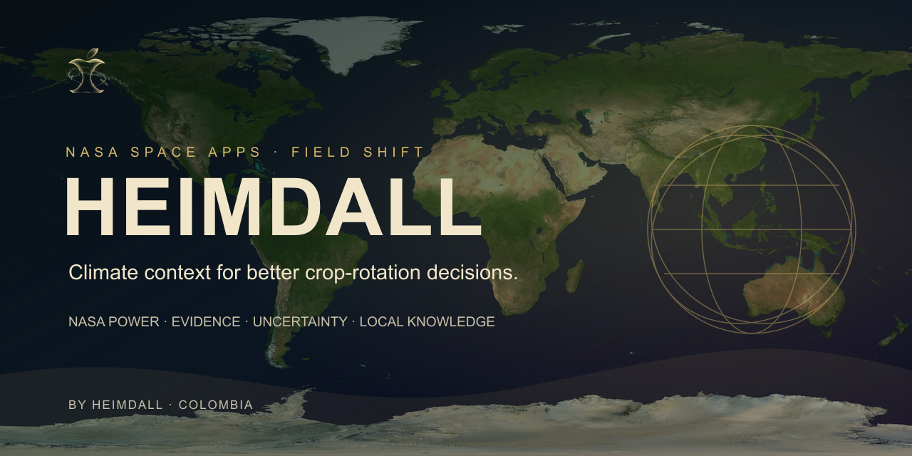

<div align="center">
  
  <h1>HEIMDALL</h1>
  <p><strong>Rotaciones de cultivo, sanidad vegetal y contexto climático con datos de NASA POWER, SRTM e IDEAM</strong></p>
  <p><a href="https://byheimdall.earth">Abrir demo</a> · <a href="docs/api-analysis.md">Contrato y datos</a> · <a href="docs/crops-rubric.md">Rúbrica de cultivos</a> · <a href="docs/crop-profiles.md">Perfiles y sanidad</a></p>
  
  <br />
  <a href="https://github.com/Becherra/Proyecto-Haimdall/actions/workflows/ci.yml"></a>
</div>

## Qué es

Heimdall ayuda a explorar alternativas de rotación y asociación de cultivos a partir de la ubicación de una finca, las prioridades de quien la trabaja y 15 años de historial climático de **NASA POWER**, combinados con elevación y pendiente de **NASA SRTM** y el **pronóstico oficial de sequía del IDEAM**. Presenta indicadores agroclimáticos, compara tres estrategias y explica la evidencia, los beneficios, los vacíos de información y los riesgos de cada una. Está pensado para el Eje Cafetero colombiano como prototipo del reto [Field Shift](https://www.spaceappschallenge.org/) (NASA Space Apps).

> **Apoyo a la decisión, no reemplazo.** Las recomendaciones, los puntajes y las notas de sanidad vegetal son preliminares; no diagnostican plagas ni enfermedades y deben contrastarse siempre con las condiciones reales del lote y un agrónomo o técnico local.

## Recorrido

1. **Ubica la finca:** busca un municipio o vereda (con autocompletado sobre Colombia), usa el GPS o traza el contorno del lote a mano alzada en el mapa satelital.
2. **Describe el cultivo y el contexto:**
   - Elige entre **12 cultivos** (10 anuales más **café** y **plátano** como permanentes actuales) o indica que hoy **no tienes cultivo**.
   - Si cultivas **café o plátano**, responde el paso guiado de **perfil y sanidad vegetal** (variedad, material de siembra en plátano, etapa y problema observado como roya, broca, moko, sigatoka negra o picudo, con opción «No sé» en cada paso).
   - Indica disponibilidad de agua y tus cinco prioridades (ahorrar agua, ganar más, cuidar el suelo, frenar la erosión, menos riesgo).
3. **Compara opciones y vigila el clima:**
   - Revisa tres estrategias (línea base o punto de partida, rotación/asociación con leguminosa y cobertura + tolerancia a sequía) con voz integrada (Web Speech), calendario mensual y desglose de evidencia, beneficios, vacíos y riesgos.
   - Consulta la tarjeta de **pronóstico de sequía del IDEAM y contexto ENSO** junto a lo que **NASA POWER ya observó** en los últimos 90 días.
   - Pon a prueba las estrategias con escenarios **«¿Y si cambia el tiempo?»** basados en los años reales más seco, más lluvioso y más cálido que vivió la zona.

## Datos y límites

| Fuente o módulo | Uso en Heimdall | Límite que mostramos |
| --- | --- | --- |
| **[NASA POWER](https://power.larc.nasa.gov/) diario** (`AG`, serie de 15 años + últimos 90 días) | Temperatura (`T2M`, `T2M_MIN`, `T2M_MAX`), precipitación (`PRECTOTCORR`), evaporación (`EVLAND` y potencial por Hargreaves–Samani), radiación solar (`ALLSKY_SFC_SW_DWN`), erosividad de la lluvia (Fournier modificado), mejores ventanas de siembra y comparación de la temporada actual | Es una celda climática regional (~0,5° × 0,625° en meteorología, ~1° en radiación); dibujar un lote no aumenta la resolución climática ni mide el predio. |
| **Humedad del suelo (`GWETROOT`, NASA POWER)** | Humedad media de la zona radicular (0–1), anomalía mensual y cruce con los meses de siembra de cada cultivo (`min–max` y alerta cuando cae bajo el 97 % de la media anual del sitio) | Es un proxy satelital/modelado a escala de celda (~50 km); se reporta como evidencia y aviso de riesgo, pero no modifica el puntaje ni reemplaza medir el suelo en el lote. |
| **NASA SRTMGL1 v003 (~30 m) en vivo y precargado** | Mide en vivo altitud media, pendiente de Horn y rango de pendientes sobre el punto o polígono del lote vía OpenTopoData (`srtm-live`); si el servicio no responde, usa lecturas SRTM precargadas en 5 puntos piloto (`srtm-sample`). Corrige temperatura y evaporación por piso térmico (~0,6 °C/100 m) | La malla de 30 m suaviza barrancos en lotes grandes y no detecta terrazas, zanjas ni obras; la muestra de respaldo solo representa el punto piloto más cercano (~9 km). |
| **Pronóstico de sequía del IDEAM y señal ENSO** (`GET /api/drought`) | Consulta el FeatureServer oficial del IDEAM (`PRONOSTICO_SEQUIA`, agregaciones de 3, 6, 9 y 12 meses, categorías `none` y `D0`–`D4`) para la zona hidrográfica y lo contrasta con la lluvia y anomalía térmica recientes de NASA POWER | Es una señal por zona hidrográfica en Colombia, no una medición de la finca ni prueba de daño actual en el cultivo; fuera de cobertura o en modo muestra se advierte explícitamente. |
| **Catálogo de cultivos (`data/crops.json`)** | 10 cultivos anuales (maíz, fríjol, soya, arveja, mucuna, crotalaria, yuca, papa, avena, repollo) y 2 permanentes (café y plátano, solo como cultivo actual para asociar en calles jóvenes) | Los puntajes 0–5 son ordinales relativos y preliminares; no son rendimientos ni precios locales, y requieren validación con un agrónomo local. |
| **Perfiles de cultivo y sanidad vegetal (`data/crop-profiles.json`)** | Fichas trazables para café y plátano (variedades, semilla, etapas y amenazas: roya, broca, moko, sigatoka negra, picudo) con citas a Cenicafé, AGROSAVIA e ICA | No es un diagnóstico fitosanitario ni altera el puntaje climático; omite recomendaciones químicas y exige confirmación oficial (ICA/extensionista) ante amenazas cuarentenarias como el moko (Res. ICA 092770/2021). |
| **Escenarios «¿Y si…?» y años extremos reales** | Pone a prueba las rotaciones con el año más seco, más lluvioso y más cálido registrados en la serie de la finca (o deltas uniformes de temperatura y lluvia) | Recrean años históricos reales o cambios uniformes sobre el pasado; no son pronósticos estacionales. |

Si faltan datos o evidencia, el análisis lo declara como vacío de información. Más detalles están en [API de análisis](docs/api-analysis.md), [contrato de finca](docs/farm-contract.md), [rúbrica de cultivos](docs/crops-rubric.md), [perfiles y sanidad vegetal](docs/crop-profiles.md), [fuentes del plan de acción](docs/action-plan-sources.md) y [muestras SRTM](docs/srtm-samples.md).

## Mapa del proyecto

```text
Proyecto-Haimdall/
├─ data/
│  ├─ crops.json                    # Catálogo de 12 cultivos (10 anuales + café y plátano)
│  ├─ crop-profiles.json            # Perfiles trazables de variedades, etapas y sanidad (café y plátano)
│  └─ samples/                      # Respaldos offline: NASA POWER (Pereira, Manizales, Armenia) y SRTM
├─ docs/                            # Contratos de API, rúbrica agronómica, sanidad, fuentes y diseño
├─ public/                          # PWA (sw.js, offline.html), texturas NASA Blue Marble y marca
├─ scripts/                         # Generadores de muestras NASA POWER/SRTM y tinte de texturas
├─ src/
│  ├─ app/
│  │  ├─ page.tsx                   # Landing con globo 3D (Three.js/partículas) → mapa → flujo de análisis
│  │  ├─ manifest.ts                # Manifiesto PWA instalable
│  │  └─ api/
│  │     ├─ analysis/route.ts       # POST /api/analysis (NASA POWER + SRTM en vivo + motor de rotaciones)
│  │     ├─ climate/route.ts        # GET /api/climate (serie diaria limpia de NASA POWER)
│  │     ├─ drought/route.ts        # GET /api/drought (pronóstico oficial de sequía del IDEAM)
│  │     └─ geocode/                # GET /api/geocode (Nominatim) y /api/geocode/suggest (Photon)
│  ├─ components/
│  │  ├─ GlobeScene.tsx             # Globo interactivo y transición de partículas (ParticleWorld.tsx)
│  │  ├─ MapScene.tsx               # Mapa satelital Leaflet con dibujo de lote a mano alzada (lazo)
│  │  ├─ PrioritiesSlides.tsx       # Tarjetas de preguntas (cultivo, perfil sanitario, agua, prioridades)
│  │  ├─ CropProfileStep.tsx        # Paso de variedad, semilla, etapa y problema observado (café/plátano)
│  │  ├─ ResultsView.tsx            # Vista campesina: 3 caminos, audio, clima, calendario y escenarios
│  │  ├─ EnsoContextCard.tsx        # Pronóstico hidrográfico IDEAM + observación reciente NASA POWER
│  │  └─ AnalysisDashboard.tsx      # Vista "¿Cómo lo sabemos?" con respaldo satelital y años extremos
│  ├─ lib/
│  │  ├─ nasaPower.ts               # Cliente NASA POWER diario/reciente, caché por celda y limpieza (-999)
│  │  ├─ terrainLive.ts             # Medición en vivo NASA SRTM 30 m (OpenTopoData) y malla (terrainGrid.ts)
│  │  ├─ terrain.ts                 # Resolución de altitud/pendiente, gradiente térmico y erosión en ladera
│  │  ├─ indicators.ts              # Balance hídrico (Hargreaves–Samani), Fournier, radiación, sequías, GWETROOT
│  │  ├─ seasonality.ts             # Meses secos/húmedos y humedad del suelo en meses de siembra
│  │  ├─ sowingWindows.ts           # Mejores ventanas de siembra deducidas del clima del sitio
│  │  ├─ currentSeason.ts           # Comparación de los últimos 90 días frente a la serie histórica
│  │  ├─ extremeYears.ts            # Años más seco, lluvioso y cálido reales de la serie para escenarios
│  │  ├─ ideamDrought.ts            # Cliente ArcGIS REST para el pronóstico de sequía del IDEAM
│  │  ├─ cropProfiles.ts            # Validador y consultas del catálogo de perfiles y sanidad vegetal
│  │  ├─ cropHealthNotes.ts         # Generador de notas sanitarias con citas y avisos regulatorios (ICA)
│  │  ├─ rotations.ts / scoring.ts  # Generación de rotaciones/asociaciones y motor explicable 0–5
│  │  ├─ geo/                       # Geometría esférica, validación de polígonos y simplificación del lazo
│  │  └─ ui/                        # Lógica pura de interfaz, textos simples, voz y estado del flujo
│  ├─ services/                     # Clientes HTTP del frontend (analysis, droughtForecast, geolocation)
│  ├─ mocks/                        # Respuestas deterministas para desarrollo sin red
│  └─ types/                        # Esquemas Zod y contratos TypeScript (index.ts, cropProfile.ts, drought.ts)
└─ tests/                           # Suite de pruebas unitarias e integración con Vitest (sin red)
```

## Ejecutar localmente

**Requisitos:** Node.js 20 o posterior y npm.

```bash
git clone https://github.com/Becherra/Proyecto-Haimdall.git
cd Proyecto-Haimdall
npm ci
```

Crea `.env.local` a partir de `.env.example` (PowerShell: `Copy-Item .env.example .env.local`):

- `GEOCODER_USER_AGENT`: identificador de tu aplicación para las consultas a Nominatim/OpenStreetMap.
- `NEXT_PUBLIC_USE_MOCKS=false`: usa las APIs reales (en `true` activa los mocks estáticos de análisis y pronóstico).
- `OPENTOPODATA_URL`: opcional; URL de una instancia propia de OpenTopoData para medir altitud y pendiente con NASA SRTM 30 m (vacío usa la instancia pública con respaldo automático en las muestras locales).
- NASA POWER e IDEAM no requieren clave de API.

```bash
npm run dev
```

Abre [http://localhost:3000](http://localhost:3000). Para ejecutar las comprobaciones del proyecto:

```bash
npm run typecheck
npm run lint
npm test
npm run build
```

## Documentación

- [Flujo de análisis en la interfaz](docs/frontend-analysis-flow.md)
- [Contrato de análisis, fuentes NASA y limitaciones](docs/api-analysis.md)
- [Contrato de finca (`Farm`)](docs/farm-contract.md)
- [Rúbrica y fuentes del catálogo de cultivos](docs/crops-rubric.md)
- [Perfiles de cultivo y sanidad vegetal (café y plátano)](docs/crop-profiles.md)
- [Inventario de fuentes del plan de acción (piloto Pereira)](docs/action-plan-sources.md)
- [Procedencia y regeneración de muestras SRTM](docs/srtm-samples.md)
- [Referencia visual y sistema de diseño](docs/design/DESIGN.md)

## English

Heimdall is an **agricultural decision-support prototype** for exploring crop rotations and intercropping in Colombia's Coffee Region. It combines 15-year daily [NASA POWER](https://power.larc.nasa.gov/) climate series (including `GWETROOT` root-zone soil wetness in sowing windows, modified Fournier rain erosivity, and solar radiation), live 30 m **NASA SRTM** elevation and slope measurements (with preloaded pilot samples as fallback), **IDEAM's official hydrographic-zone drought forecast**, and a source-backed **plant health and crop profile module** for coffee and plantain (Cenicafé, AGROSAVIA, ICA).

Results are preliminary decision support: NASA POWER describes regional grid cells, `GWETROOT` is a coarse proxy rather than a field soil sensor, crop scores are relative and unvalidated by a local agronomist, and plant-health notes are non-diagnostic context. To run locally, use Node.js 20+, run `npm ci`, copy `.env.example` to `.env.local`, set `GEOCODER_USER_AGENT`, and run `npm run dev`.

## Reconocimientos

Los datos climáticos proceden de [NASA POWER](https://power.larc.nasa.gov/), la topografía de [NASA SRTMGL1 v003](https://www.earthdata.nasa.gov/data/catalog/lpcloud-srtmgl1-003) (servida en vivo por [OpenTopoData](https://www.opentopodata.org/)) y el pronóstico de sequía del [IDEAM](http://www.ideam.gov.co/). Los perfiles fitosanitarios citan publicaciones de Cenicafé, AGROSAVIA e ICA. El mapa utiliza imágenes de Esri y datos de OpenStreetMap. La textura terrestre se basa en [NASA Blue Marble](https://svs.gsfc.nasa.gov/2915), acreditada en [su documentación](public/textures/README.md). Heimdall es un proyecto independiente y no implica respaldo oficial de la NASA ni de las entidades citadas.
